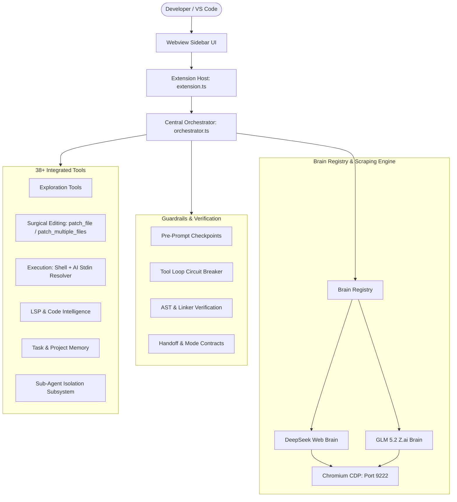
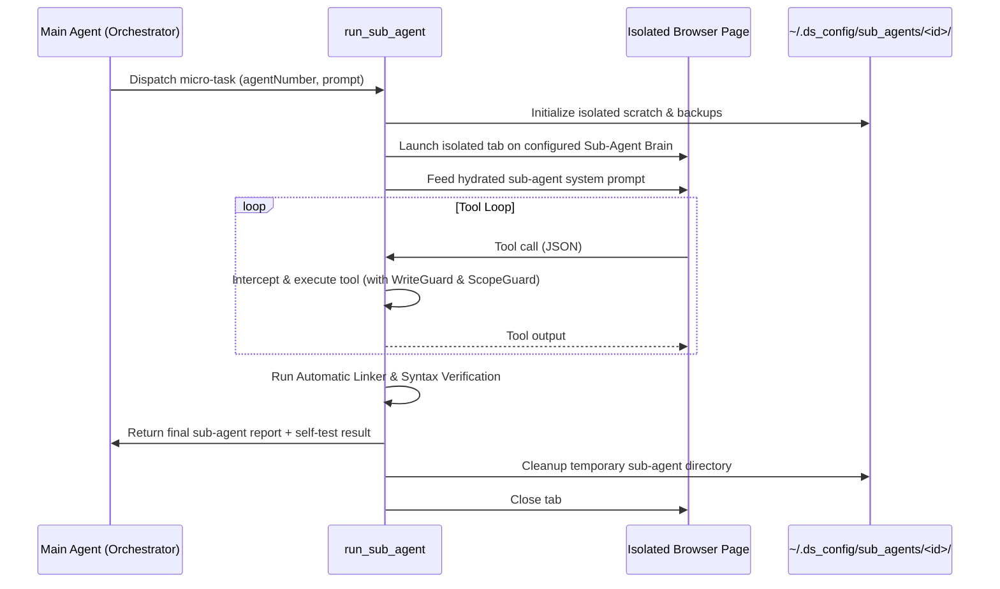

# DeepSeek CLI / VS Code Extension: Comprehensive System Specification

> **Version**: 1.2.2  
> **Target Environment**: VS Code / VSCodium (>= 1.80.0), Node.js (>= 18), Linux / macOS / Windows  
> **Primary Interfaces**: VS Code Sidebar Webview, CLI Terminal UI (TUI)  
> **AI Backends**: DeepSeek Web (`chat.deepseek.com`), GLM 5.2 / Z.ai Web Automator (`chat.z.ai`) via Playwright CDP  

---

## 1. Executive Summary & Core Value Proposition

DeepSeek CLI is a developer-centric AI coding assistant and agentic harness operating inside VS Code. Rather than relying on expensive, rate-limited, or proprietary cloud API keys, the extension leverages headless or headed Chromium browser automation via the Chrome DevTools Protocol (CDP) to interface directly with state-of-the-art web LLMs (DeepSeek R1/V3 and Z.ai GLM 5.2). 

It features:
- **Zero API Key Requirement**: Direct Playwright automation over local Chromium CDP.
- **Dual-Model Selection**: Independently assign distinct AI brains to the **Main Brain** and the **Sub-Agent Scraper**.
- **38+ Built-in Specialized Tools**: Covering surgical diff-based editing, AST code intelligence, LSP operations, git workflows, and persistent memory.
- **Fail-Safe Agentic Harness**: Automatic pre-prompt checkpoints, circuit breakers, linker checks, conflict marker guards, shrinkage detection, and mandatory verification testing.
- **Agentic Interactive Shell Resolution**: Monitors terminal output in real time and automatically resolves interactive prompts (`[y/n]`, option numbers) via an isolated AI query.

---

## 2. Core Architecture & Subsystems



### 2.1. Dual-Brain Scraping Architecture
1. **DeepSeek Web Brain (`deepseek-web.ts`)**:
   - Automates `chat.deepseek.com` via Playwright.
   - Connects to a persistent user session via Chromium CDP (`--remote-debugging-port=9222`, user profile at `~/.ds_config/scraper-profile`).
   - Hooks directly into network streams (`window.fetch` and `XMLHttpRequest`) via init scripts to intercept raw SSE chunks (`/api/v0/chat/completion`).
   - Separates reasoning chunks (`THINK`) from answer tokens (`RESPONSE`) in real time.
2. **GLM 5.2 / Z.ai Brain (`glm-web.ts`)**:
   - Automates `chat.z.ai`.
   - Injects stream readers intercepting `/api/v2/chat/completions`.
   - Supports both `textarea` and `contenteditable` inputs with multi-retry selector resolution.
   - **Multilingual Button Disambiguation**: Uses attribute and label filtering (including Chinese: `思考`, `搜索`, `联网`) to ensure send actions never accidentally click or disable "Deep Thinking" or "Web Search" toggle buttons.
3. **Resilience & Startup Optimizations**:
   - **`gotoWithWait` Navigation**: Bypasses slow favicons or tracker downloads by resolving page navigation on `domcontentloaded` and waiting up to 5s for the chat input element.
   - **No-Timeout Stream Startup**: Removed artificial chunk start timeouts, allowing scrapers to wait indefinitely for high-latency thinking models without prematurely reloading tabs or opening orphan chats.

### 2.2. Tool Normalization & Parser Engine (`src/tools/index.ts`)
LLMs often emit malformed JSON, markdown-wrapped JSON, single-quoted keys, or mixed arrays. DeepSeek CLI's normalizer:
- Extracts JSON across triple-backtick fences and naked braces.
- Repairs trailing commas, missing quotes around keys, and trailing arrays.
- Normalizes single tool calls, parallel tool call arrays (`{"tools": [...]}`), and legacy parameter formats.
- Automatically remaps unrecognized tool names with a `prompt` field to `run_sub_agent`.

---

## 3. Operational Modes & Cognitive Frameworks

| Mode | Allowed Tools | Blocked Operations | Purpose |
|------|---------------|-------------------|---------|
| **ACT** | All 38+ tools, mutating shell commands, sub-agents | Unverified file saves, skipping self-test | End-to-end task execution and implementation |
| **PLAN** | Read-only tools, read-only shell (`ls`, `cat`, `git log`) | `patch_file`, `patch_multiple_files`, mutating shell commands | Architecture design, step breakdown, zero-code analysis |
| **AUTO** | Dynamic per-turn switching (ACT or PLAN) | Depends on auto-detected mode | Auto-detects user intent using keyword scoring across 10+ languages |
| **Brainstorm** | Web research, multi-tab specialist critique | Coding tools during analysis phases | Multi-agent research pipeline for architectural validation |

### 3.1. The 6-Step ACT Cycle
1. **DISCOVER**: Check for existing workflow files via `find_workflow`.
2. **UNDERSTAND**: Ingest user request; if ambiguous, call `ask_user`; initialize `codebase_summary` if exploring a fresh repo.
3. **RESEARCH**: Read files, search symbols, find references, and map dependencies before editing.
4. **EXECUTE**: Read the target file first, apply surgical patches via `patch_file` / `patch_multiple_files`, and run sub-agents in parallel when multi-file edits are independent.
5. **VERIFY**: Run unit tests, type checkers, and linters automatically.
6. **SELF-AUDIT**: Review git diffs, ensure zero lint warnings, and provide the mandatory `PASS  Self-test:` result.

### 3.2. Brainstorm Pipeline (`src/core/brainstorm/engine.ts`)
A dedicated 7-tab reasoning pipeline:
- **Level 0 (Web Research)**: Searches for market data, prior art, and competitor failures.
- **Level 1 (Three Specialists)**: Parallel tabs analyze Infrastructure, Security, and Core Logic.
- **Level 2 (Jury Panel)**: Critical Analyst, Review Panel, and Foreman models challenge L1 findings.
- **Level 3 (Blueprint)**: Generates a research-grounded technical architecture.
- **Destructive Critique Loop**: Fresh browser tabs iterate against the blueprint until issues reach zero.
- **Final Verdict**: Issues a definitive `BUILD`, `ABANDON`, or `PIVOT` determination with evidence stored in `~/.ds_config/brainstorm_evidence/<timestamp>/`.

---

## 4. Comprehensive 38+ Tools Reference

### 4.1. Exploration & Analysis
- **`codebase_summary`**: Generates a top-level repository map, directory hierarchy, language breakdown, and key configuration identification.
- **`list_directory`**: Lists directory entries with file sizes, types, and pagination.
- **`file_info`**: Inspects metadata (size, permissions, line count, modified time) without reading full file bytes into context.
- **`read_file`**: Reads file content with 1-based line numbers. Supports line ranges (`start_line`, `end_line`) to conserve tokens.
- **`glob_search`**: Fast pattern matching across files and directories (respects `.gitignore` and `.dsignore`).
- **`grep_search`**: Regex-based text search across the entire project or targeted directories.
- **`quick_search`**: Context-enhanced grep returning matching lines with surrounding context lines.
- **`get_file_diff`**: Generates unified diffs between the working tree, git HEAD, or automated file backups.
- **`get_recent_errors`**: Summarizes the pattern of tool failures in the current turn and recommends next steps.

### 4.2. Surgical File Editing
- **`write_file`**: Creates **new** files. *Hard safety guard*: Rejects execution if the file already exists to prevent accidental overwrites.
- **`patch_file`**: Performs surgical modifications on existing files. Supports:
  - *String-match mode (Preferred)*: `find_string` + `replace_string` (immune to line drift).
  - *Line-range mode (Fallback)*: `start_line` + `end_line` + `new_content`.
- **`patch_multiple_files`**: Applies an atomic batch of edits across multiple files with automatic rollback if any single patch fails. Includes strict path verification.
- **`restore_file`**: Reverts an edited file to its automatic backup version stored in `~/.ds_config/backups/`.

### 4.3. Terminal & Execution
- **`execute_shell_command`**: Spawns shell processes with configurable timeout, working directory, and automatic retries. Features:
  - Real-time stream monitoring for interactive prompts (`Ok to proceed? (y/n)`, numbers).
  - Automatic AI sub-queries that answer stdin prompts dynamically.
  - Proper Promise rejection on non-zero exit codes to ensure harness error tracking.
- **`git_operation`**: Safe git management wrapper supporting `status`, `diff`, `log`, `branch`, `checkout`, and `stash`.
- **`run_tests`**: Auto-detects test runners (Jest, Vitest, Mocha, Pytest, Go test, Cargo) and runs targeted test suites.

### 4.4. Code Intelligence & Language Server Protocol (LSP)
- **`lsp_diagnostics`**: Queries language servers (`tsserver`, `pyright`, `gopls`, `rust-analyzer`) for compilation and type errors.
- **`lsp_hover`**: Extracts exact type signatures, documentation, and interface definitions at specific line/character coordinates.
- **`lsp_find_references`**: Retrieves all cross-file symbol references via LSP.
- **`lsp_rename`**: Performs project-wide semantic symbol renames across all files.
- **`find_references`**: Tree-sitter AST-based reference search.
- **`go_to_definition`**: Tree-sitter AST-based definition locator.
- **`get_symbol_info`**: Detailed symbol inspection including scope, kind, and callers.
- **`repo_map`**: Builds an AST structural map of functions, classes, and exported interfaces.
- **`lint_code`**: Runs project linters (ESLint, Prettier, Ruff, Flake8) with optional `--fix`.

### 4.5. Memory, State & Collaboration
- **`update_task`**: Manages persistent `task.md` plans (steps, status, current goals) in `~/.ds_config/scratch/`.
- **`update_project_memory`**: Writes persistent operational conventions and architecture patterns to `AGENTS.md`.
- **`write_scratch_file`**: Stores temporary notes, intermediate data, or plans in the session scratchpad.
- **`read_scratch_file`**: Reads back temporary session scratch files.
- **`list_scratch_files`**: Lists all temporary files stored for the active session.
- **`ask_user`**: Halts execution and presents a clarifying question or multi-choice prompt to the user in the UI.

### 4.6. Snapshots, Sub-Agents & Workflows
- **`snapshot_state`**: Captures a full workspace state stash with custom labels.
- **`restore_to_snapshot`**: Rolls back the working directory to a previous snapshot state.
- **`run_sub_agent`**: Spawns an isolated micro-agent in a dedicated browser tab to execute a scoped sub-task.
- **`find_workflow`**: Searches installed workflow `.md` instruction templates.
- **`get_workflow_content`**: Loads and hydrates a workflow template.
- **`search_tool_registry`**: Discovers external MCP tools and registry commands.

---

## 5. Sub-Agent Micro-Tasking Subsystem



- **Dedicated Scraper Configuration**: Can be configured to run on a different model than the main brain (e.g., DeepSeek for main coding, GLM 5.2 for sub-agent research).
- **Hard Boundaries**:
  - Sub-agents cannot invoke `run_sub_agent` (recursion strictly forbidden).
  - Sub-agents cannot call `write_file` on existing files (must use surgical patching).
  - Sub-agents must conclude with a `PASS  Self-test:` result line.
  - Sub-agents cannot write to global session history.
- **Automated Verification Gate**: Before a sub-agent is permitted to complete, the harness runs syntax checks, linker checks, and build scripts against modified files. If verification fails, the sub-agent is re-prompted to fix errors.

---

## 6. Guardrails, Safety & Automated Verification

### 6.1. Linker Checks (Post-Edit Engine)
After every file modification, the orchestrator executes automated AST and semantic verification:
1. **Import/Export Validation**: Verifies that newly imported symbols actually exist in the target file's exports.
2. **Deleted Reference Check**: Scans the workspace to verify that deleted or renamed methods are not still referenced elsewhere.
3. **Undeclared Dependency Check**: Detects non-relative package imports that are absent from `package.json`.
4. **Conflict Marker Detection**: Flags leftover git merge artifacts (`<<<<<<<`, `=======`, `>>>>>>>`).
5. **JSON Syntax Integrity**: Validates modified JSON files and reports line/column coordinates for parse errors.
6. **File Shrinkage Guard**: Triggers a critical warning if a file is truncated by >30% without explicit refactoring documentation.

### 6.2. Circuit Breakers & Loops
- **Loop Circuit Breaker**: If the AI attempts the exact same tool call with identical arguments 3 times consecutively, the orchestrator aborts execution and forces an alternative approach.
- **Anti-Hallucination & Anti-Blind Editing**: Mandates reading files before patching. Enforces `find_string` over line numbers to eliminate line-drift bugs.
- **Lazy Comment Blocker**: Blocks patches containing placeholder comments (`// ... rest of code`, `/* todo */`).

### 6.3. The Self-Test Protocol
Every final assistant message in ACT mode must terminate with a verification result line:
```
PASS  Self-test: <test command> -> <expected output>
PASS  Self-test skipped: <valid reason for omitting test>
FAIL  Self-test: <test failure details>
```
If missing, the orchestrator intercepts the response and forces a retry.

---

## 7. Terminal Automation & Interactive Prompt Resolution

In standard agent setups, terminal commands that ask interactive questions (e.g. `npm create`, `git add -p`, package installations asking `Ok to proceed? (y/n)`) hang indefinitely or fail when `-y` flags are removed.

DeepSeek CLI implements an **Agentic Interactive Resolver**:
1. `execute_shell_command` runs commands via `spawn` with piped stdio.
2. Real-time stream listeners watch stdout/stderr for question prompts matching patterns like `[y/n]`, `Ok to proceed?`, `select an option:`, or `(1-4):`.
3. When detected, the executor creates a lightweight, isolated browser tab and prompts the active AI:
   > *"A terminal command is executing and waiting for input. Command: `<cmd>`. Terminal prompt: `<prompt>`. What should we answer to proceed successfully? Respond ONLY with the exact characters."*
4. The AI's decision (e.g. `y`, `1`, `Enter`) is fed directly into the child process's `stdin`.
5. If the command fails or times out, the tool rejects its Promise, ensuring `get_recent_errors` catches and summarizes the failure.

---

## 8. State, History & Workspace Persistence

All persistent agent data resides under `~/.ds_config/`:

```
~/.ds_config/
├── config.json                     # Core configuration & selected model preferences
├── AGENTS.md                       # Long-term global project memory & conventions
├── scraper-profile/                # Persistent Chromium browser profile & session cookies
├── sessions/                       # Conversation storage
│   ├── index.json                  # Session index, titles, timestamps
│   └── <session-id>.jsonl          # Raw message exchanges, thinking blocks, tool logs
├── checkpoints/                    # Pre-prompt workspace snapshots
│   └── cp_<timestamp>/
│       ├── meta.json               # Checkpoint metadata & trigger prompt
│       └── files/                  # Backup copies of modified files
├── backups/                        # Pre-patch file backups
├── scratch/                        # Per-session scratch files (task.md, notes)
│   └── <session-id>/
├── sub_agents/                     # Sub-agent temporary isolated workspaces
│   └── <agent-id>/
├── workflows/                      # Community and custom workflow templates (.md)
└── brainstorm_evidence/            # Comprehensive evidence logs from Brainstorm mode
```

### 8.1. Pre-Prompt Checkpoints
Before executing any user prompt:
1. Runs `git status --porcelain` to identify dirty or modified workspace files.
2. Backs up affected files to `~/.ds_config/checkpoints/cp_<timestamp>/`.
3. The user can revert at any point using `/revert <checkpoint_id>`.

---

## 9. UI & Webview Experience Innovations

The VS Code sidebar UI (`src/webview/sidebar.html`) contains several purpose-built UX features:

- **Sectioned "Models" Dropdown**: A single dropdown menu housing independent sub-menus for **Main Brain** and **Sub-Agent Scraper** (DeepSeek vs GLM 5.2). Selections persist across restarts.
- **Prompt Queue with Delete Badges**: Users can type and queue multiple prompts while the agent is actively executing tools. Queued prompts render as removable badges with individual delete buttons.
- **Non-Blocking Inputs**: Input fields and submission buttons remain interactive during tool execution so developers are never locked out of queueing follow-up work.
- **Zero-Waste Markdown Rendering**: Custom fence renderers strip unnecessary top and bottom padding from code blocks; `.thinking-content` styling removes excessive blank lines while keeping reasoning blocks collapsible.
- **Live Mode Badges & Token Tracker**: Real-time display of active mode (`ACT`, `PLAN`, `AUTO`, `BRAINSTORM`) and estimated context budget usage.

---

## 10. Extensibility via MCP (Model Context Protocol)

DeepSeek CLI includes a native Model Context Protocol client (`src/mcp/mcp_loader.ts`):
- Connects to stdio MCP servers declared in `~/.ds_config/mcp.json`.
- Dynamically discovers tool definitions, parameter schemas, and descriptions.
- Exposes MCP tools directly to the AI with automatic JSON schema translation.
- Comes pre-bundled with `@playwright/mcp` and `mcp-server-git`.
- Users can install external MCP servers directly via `/install-mcp <name> <package> [args...]`.

---

## Summary Reference Table

| Feature Area | Key Mechanism | Benefit |
|--------------|---------------|---------|
| **Scraper** | Playwright CDP over port 9222 | Free, zero-API-key access to flagship web models |
| **Model Freedom** | Dual Model Selection | Mix and match different brains for main planning vs sub-agent tasks |
| **Navigation** | `gotoWithWait` (`domcontentloaded`) | Eliminates UI freezing caused by slow favicons/trackers |
| **Safety** | Pre-Prompt Checkpoints | 1-click full workspace rollback before any prompt runs |
| **Code Editing** | `patch_file` string matching | Immune to line-drift; prevents full-file destructive rewrites |
| **Integrity** | Linker & AST verification | Catches missing exports, broken imports, and orphan references immediately |
| **Terminal** | Real-time stdin prompt AI resolver | Handles interactive terminal prompts automatically without `-y` hacks |
| **Task Queue** | Interactive badge queue with deletes | Queue multiple instructions without waiting for tool runs to finish |
| **Architecture** | 7-Tab Brainstorming Engine | Multi-model peer review and destructive critique for bulletproof designs |
